<p align="center">
  
</p>

## 🎯 About Me

<table>
<tr>
<td width="58%" valign="top">

```python
usama = {
    "role": "AI/ML Engineer in training",
    "study": "BS Artificial Intelligence @ UMT",
    "years": "2023 - 2027",
    "location": "Lahore, Pakistan",

    "building": [
        "RAG systems with cited answers",
        "Tool-using AI agents",
        "Multi-agent workflows",
    ],

    "learning": [
        "LLM evaluation",
        "Deploying AI apps",
        "MLOps",
    ],

    "tech": {
        "ai": ["LangGraph", "ChromaDB",
               "TensorFlow", "scikit-learn"],
        "llm": ["Groq", "Llama 3.3"],
        "web": ["HTML", "CSS", "JS", "React"],
        "tools": ["Git", "pytest", "Streamlit"],
    },
}
```

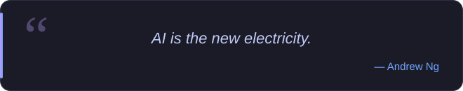

</td>
<td width="42%" valign="top">
  
  
</td>
</tr>
</table>

## 📫 Connect With Me

<p align="center">
  <a href="https://www.linkedin.com/in/muhammad-usama-amjad-409b39363/"></a>
  <a href="https://github.com/usamaamjad1579?tab=repositories"></a>
  
</p>

## 🛠️ Tech Stack

<p align="center">
  
</p>

<p align="center">
  
  
  
  
  
  
  
  
  
  
  
  
  
</p>

## 🚀 Featured Projects

<p align="center">
  <a href="https://github.com/usamaamjad1579/rag-document-chat">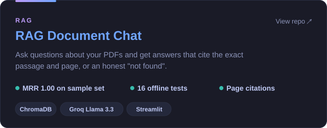</a>
  <a href="https://github.com/usamaamjad1579/agentic-research-assistant">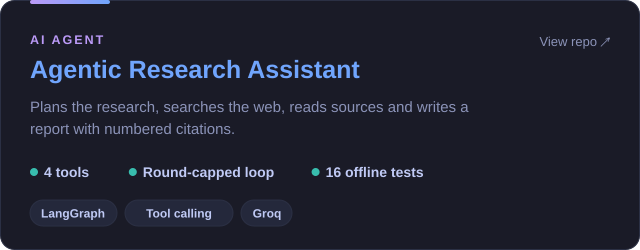</a>
</p>
<p align="center">
  <a href="https://github.com/usamaamjad1579/multi-agent-content-studio">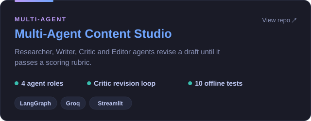</a>
  <a href="https://github.com/usamaamjad1579/deep-learning-sequence-models">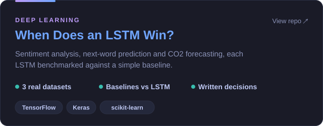</a>
</p>

## 📊 GitHub Analytics

<p align="center">
  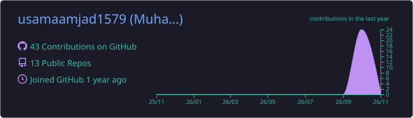
</p>
<p align="center">
  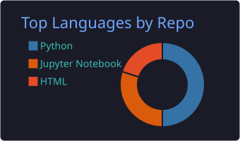
  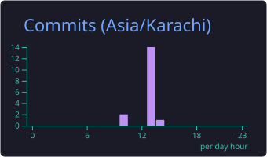
</p>
<p align="center">
  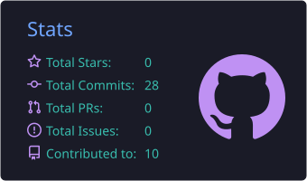
  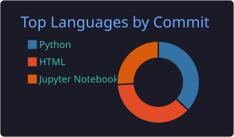
</p>

## 🏆 GitHub Trophies

<p align="center">
  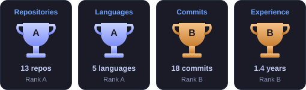
</p>

<sub>The analytics cards and trophies refresh every day with GitHub Actions.</sub>
